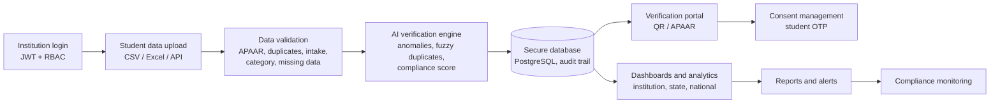

# SANJAYA

**Student Academic Network for Joint APAAR Yield & Authentication**

An APAAR ID-based student data management and verification platform for AICTE-approved institutions.


> One Student. One Identity. One Verified Journey.

---

## Table of contents

1. [Problem statement](#problem-statement)
2. [What SANJAYA does](#what-sanjaya-does)
3. [Key features](#key-features)
4. [How it works](#how-it-works)
5. [Validation rules](#validation-rules)
6. [Tech stack](#tech-stack)
7. [Project status](#project-status)
8. [Try the prototype](#try-the-prototype)
9. [Repository structure](#repository-structure)
10. [Security and privacy](#security-and-privacy)
11. [Impact](#impact)
12. [Roadmap](#roadmap)
13. [References](#references)
14. [Team](#team)
15. [Disclaimer](#disclaimer)

---

## Problem statement

| | |
|---|---|
| **Hackathon** | Smart India Hackathon 2026 |
| **Problem Statement ID** | 26263 |
| **Title** | Development of an APAAR ID-Based Student Data Management and Verification Platform for AICTE-Approved Institutions |
| **Theme** | Smart Automation |
| **Category** | Software |
| **Team** | GitMinds (Team ID 199235) |

AICTE receives detailed student data from PGDM institutions, but most other approved institutions report only aggregate figures such as total enrolment during the approval process. This makes it hard for AICTE to:

- verify individual student records,
- detect admissions beyond approved intake,
- identify students enrolled at more than one institution, and
- give employers and regulators a trustworthy way to verify a student or a degree.

APAAR ID, India's national academic identifier, offers a common key to fix this.

## What SANJAYA does

SANJAYA uses APAAR ID as the single identifier for every student. Institutions submit student-level data, the platform validates it against APAAR and approved-intake rules, an AI layer flags duplicates and suspicious admission patterns, and verified records feed real-time dashboards and consent-based verification for AICTE, institutions, employers and regulators.

```
Institution -> Data upload -> Validation -> AI verification -> Central repository -> Monitor and verify
```

## Key features

| Area | What it provides |
|---|---|
| **Secure data submission** | Institution login, CSV/Excel upload or API, covering approved intake, actual enrolment, supernumerary seats, NRI, OCI and FN categories |
| **Automated validation** | APAAR ID format, missing fields, duplicate students, category checks and admissions beyond approved intake, with row-wise error reports so institutions can fix and resubmit |
| **AI verification engine** | Cross-institution duplicate detection (fuzzy matching), suspicious admission spike detection using Isolation Forest, and an institution compliance score |
| **Real-time dashboards** | Institution dashboard for admission status, errors and compliance; AICTE dashboard for national analytics, alerts, state-wise and branch-wise trends, and seat utilisation |
| **Consent-based verification** | Employers, regulators and universities verify a student by APAAR ID or certificate QR code, with student consent (OTP), role-based access and audit logs |
| **Reports and alerts** | One-click reports for policy, accreditation and monitoring, plus email/SMS alerts |

## How it works



**User roles**

| Role | Can do |
|---|---|
| College registrar | Upload data, view row-wise errors, track intake and compliance |
| AICTE official | Monitor all institutions, alerts, duplicates and reports |
| Employer or regulator | Verify a student with the student's consent |
| University registrar | Receive verified admissions and issue certificates carrying the APAAR ID and QR |

## Validation rules

| Check | Outcome |
|---|---|
| APAAR ID missing or wrongly formatted | Rejected, or held as pending where an ID is not yet available |
| Duplicate student within an upload | Rejected as duplicate |
| Duplicate across institutions | Flagged for review |
| Admissions beyond approved intake | Alert to AICTE and the institution |
| Category validation (supernumerary, NRI, OCI, FN) | Flagged where the category is not approved for the course or the seat limit is exceeded |
| Missing or inconsistent fields | Returned in the row-wise error report |

Intake and category rules are configurable so AICTE can update norms without rewriting code.

## Tech stack

| Layer | Technology |
|---|---|
| Frontend | React, Tailwind CSS |
| Backend | Python, FastAPI, REST APIs |
| Database | PostgreSQL |
| AI/ML | scikit-learn (Isolation Forest, Random Forest), XGBoost, RapidFuzz, Pandas |
| Security | JWT authentication, role-based access control (RBAC), HTTPS |
| Infrastructure | Docker, Nginx |

## Project status

This repository is a hackathon prototype.

- [x] Problem analysis and solution design (see `docs/`)
- [x] Clickable front-end prototype with mock data and role-based demo logins
- [ ] FastAPI backend and database
- [ ] APAAR verification adapter (the prototype uses mock data; production would use official APAAR/ABC access)
- [ ] ML models for anomaly detection and fuzzy duplicate matching
- [ ] Consent (OTP) service and signed QR credentials
- [ ] Integration with institution ERPs and the AICTE portal

Tick the boxes as you complete each item.

## Try the prototype

The prototype is a single HTML file with no backend, so there is nothing to install.

1. Download or clone this repository.
2. Open `prototype/index.html` in any modern browser.
3. Choose a role on the home screen. No password is checked in the demo.

**Suggested walkthrough**

1. **College registrar** -> *Upload and validate* -> *Load sample batch and validate*. A 13-record batch runs through the validation rules and shows Verified, Pending and Flagged rows with reasons, then *Submit verified records to AICTE*.
2. **AICTE official** -> view national monitoring, alerts, cross-institution duplicates and reports.
3. **Employer or regulator** -> *Verify a student*. Use APAAR ID `482910374655` or `388105927461`; the demo OTP is `4821`. The result masks name details and hides category data.
4. **University registrar** -> *Certificate preview* to see a certificate showing the APAAR ID next to the student ID with a demo QR code.

All names, institutions, IDs and figures in the prototype are fictional.

To host it, enable **GitHub Pages** (Settings -> Pages -> deploy from the branch containing `prototype/`) and share the link.

## Repository structure

Adjust this to match your repository.

```
.
├── README.md
├── prototype/
│   └── index.html          # front-end demo with mock data
├── docs/
│   └── GitMinds.pdf        # final SIH presentation
├── frontend/               # planned: React app
├── backend/                # planned: FastAPI services
└── ml/                     # planned: anomaly detection and matching
```

## Security and privacy

SANJAYA is designed around the Digital Personal Data Protection Act, 2023:

- **Authentication and access:** JWT login with role-based access control, so each role sees only what it needs.
- **Consent:** third-party verification requires the student's consent through a one-time code, and shares only the fields needed.
- **Data protection:** encrypted storage, HTTPS in transit, and data minimisation.
- **Auditability:** immutable logs and an audit trail for uploads, verifications and administrative actions.

## Impact

- Verified student-level records replace unverifiable aggregate enrolment numbers.
- Invalid IDs, duplicate enrolment and excess admissions are caught at upload, not after inspections.
- Live intake-versus-enrolment tracking and alerts replace slow periodic reporting.
- State-wise, branch-wise and category-wise analytics support approvals, accreditation and policy decisions.
- Students get one lifelong academic identity with consent-based control over who can verify their records.

## Roadmap

1. **Prototype:** front-end demo with mock data (done) and core backend with validation rules.
2. **Pilot:** a small group of institutions in one state, with a mock or sandbox APAAR adapter.
3. **Scale:** API-first rollout to more institutions as integrations and rules mature.

## References

- APAAR portal and Academic Bank of Credits (Ministry of Education)
- National Academic Depository (NAD) and DigiLocker
- AICTE Approval Process Handbook
- Digital Personal Data Protection Act, 2023 (MeitY)
- scikit-learn documentation: Isolation Forest
- Liu, Ting and Zhou, *Isolation Forest*, IEEE ICDM 2008
- RapidFuzz library documentation

## Team

**GitMinds**, Netaji Subhash Engineering College (NSEC)

| Name | Role | GitHub |
|---|---|---|
| Sohan Paul | Team lead | [@username](https://github.com/sohan-paul) |
| Devansh Sengupta | Participant | [@username](https://github.com/username) |
| Roushan Kumar Yadav | _Role_ | [@username](https://github.com/username) |
| Rohan Agarwal| _Role_ | [@username](https://github.com/username) |
| Subhojit Mallick | _Role_ | [@username](https://github.com/username) |
| Sohali Das | _Role_ | [@username](https://github.com/username) |

## Disclaimer

SANJAYA is a hackathon prototype built for Smart India Hackathon 2026. It is not an official AICTE, Ministry of Education or APAAR product. The prototype uses mock data only and does not connect to any government system yet.

## License

Add a `LICENSE` file before publishing. MIT is a common choice for hackathon projects, but choose what suits your team.
